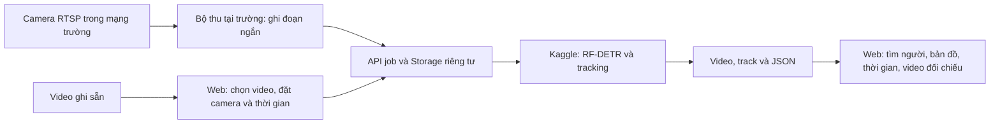

# Ứng dụng camera khuôn viên

## Bản web theo bài báo — 2026-10-28

Ứng dụng mới nằm tại `/workspace`, gồm Tổng quan, Camera, Video, Tìm người, Hành trình,
Lịch sử và Nghiên cứu. Các địa chỉ trang chính cũ chuyển về màn hình mới tương ứng.
Camera, lịch sử và ghi chú lưu theo không gian riêng trên Storage; khóa 256 bit lưu
ở trình duyệt và có thể sao lưu thành file. API kiểm tra quyền từng workspace và từng job.
Xem `WORKSPACE_GUIDE.md` để sử dụng và `FINAL_WEB_SPEC.md` để đối chiếu yêu cầu bài báo.

Đã bổ sung lịch sử riêng, tiếp tục phiên tải dở, quyết định đối chiếu thủ công có nhật ký,
đánh dấu vào/ra theo giây trong video và xuất dữ liệu. Các mục mở rộng sản xuất bên dưới
(phân vai tổ chức, live liên tục, Re-ID học sâu, GPU luôn sẵn sàng) vẫn là phần riêng;
không đồng nghĩa hoàn thành chỉ vì web đã có màn hình.

## Luồng vận hành



Hai nguồn dùng chung một hàng đợi và một định dạng kết quả. Web không mở kết nối
RTSP trực tiếp; Kaggle cũng không cần truy cập mạng nội bộ của trường.

## Đã có trong phiên bản code này

- Video tải lên: đặt tên, mốc bắt đầu tương đối, vị trí từng camera; lưu cùng job trên Storage.
- Mốc không biết được giữ là không biết. Không tự đặt camera cách nhau 30 giây.
- Chọn track, xem các lần xuất hiện và các ứng viên liên kết trực tiếp, mở đúng đoạn video.
- Chưa có tọa độ thì hiện sơ đồ camera với số track từ kết quả thật, không bịa vị trí GPS.
- Bản đồ từ tọa độ do người vận hành cung cấp. Nét đứt là quan hệ ứng viên giữa camera,
  không phải quỹ đạo hay tuyến đường được quan sát trong vùng không có camera.
- Bộ thu RTSP: 2–3 nguồn song song, đoạn 1–30 giây, timeout cứng cho mỗi nguồn;
  tài khoản camera chỉ nằm trong biến môi trường của máy thu.
- File access.json cho phép mở phiên đó trên web. Đây là quyền truy cập riêng của job,
  không phải mật khẩu camera hoặc tài khoản quản trị.

## Chạy bộ thu

Máy thu cần Python và dependencies của backend + `backend/requirements-multicam.txt`
(PyAV, OpenCV, NumPy, httpx). Decoder dùng thư viện FFmpeg qua PyAV, không cần lệnh
ffmpeg trong PATH. Chạy từ thư mục gốc dự án:

```powershell
Copy-Item config/camera-gateway.example.json .cache/camera-gateway.json
# Thiết lập CAMPUS_GATE_RTSP và CAMPUS_YARD_RTSP trong môi trường của máy thu.
# Sửa file cấu hình: tên/vị trí thật và consent=true nếu có quyền xử lý.
.venv/Scripts/python.exe -m backend.camera_gateway --config .cache/camera-gateway.json --check
.venv/Scripts/python.exe -m backend.camera_gateway --config .cache/camera-gateway.json
```

Worker Kaggle phải hoạt động. Sau khi gửi thành công, mở `/demo` → **Camera RTSP** →
chọn access.json ở đường dẫn chương trình thông báo. Tiến độ và kết quả cập nhật qua
job API hiện có. File này chứa quyền đọc/xóa job: không đưa vào Git hoặc gửi công khai.
Thư mục `.cache` đã được bỏ qua bởi Git. Các đoạn ghi giữ trên máy thu để kiểm tra;
chưa có cơ chế tự động dọn theo thời hạn.

Để kiểm tra với video ghi sẵn từ bộ thu, thay `rtsp_url_env` bằng `video_path`
(đường dẫn tương đối với file cấu hình hoặc đường dẫn tuyệt đối).
`timeline_start_seconds` là tùy chọn: chỉ điền nếu biết các mốc ghi hình tương ứng.
Với RTSP, thời điểm khởi chạy chương trình không được coi là thời điểm phơi sáng của
frame; để trống mốc khi chưa đồng bộ. Khi thiếu mốc, worker bỏ ghép ID liên camera,
vẫn trả detection và local track. Tọa độ tùy chọn có dạng
`"location": {"lat": <vĩ độ thật>, "lng": <kinh độ thật>}`.

Bộ thu hiện chạy một lần theo lệnh. Nó **không** phải phát trực tiếp HLS/WebRTC hoặc
dịch vụ giám sát liên tục. Không tăng vòng lặp gửi job trên demo công khai: hàng đợi
hiện có giới hạn 20 lượt/IP/ngày và 30 lượt toàn hệ thống/ngày, job hết hạn sau 24 giờ.
Upload lỗi giữ file gốc và access.json; lỗi xác nhận cuối có thể thử xác nhận lại trên
web. Nếu chưa tải đủ byte, cần kiểm tra kết nối trước khi gửi phiên mới.

## Điều kiện để gọi là ứng dụng hoàn chỉnh triển khai tại trường

1. Tài khoản người vận hành, phân quyền theo cơ sở và nhật ký truy cập/thao tác.
2. Nhận dạng và hồ sơ người xuyên nhiều job. Danh mục camera và lịch sử phiên đã có;
   việc ghép danh tính xuyên phiên vẫn cần mô hình Re-ID và cơ sở vector được kiểm thử.
3. Gateway chạy như dịch vụ: lịch ghi, reconnect, hàng đợi bền vững, giám sát sức khỏe,
   chính sách lưu/xóa, truyền live HLS/WebRTC nếu cần xem trực tiếp.
4. GPU worker luôn hoạt động cho nhu cầu liên tục; Kaggle hiện phù hợp thử nghiệm,
   không phải cam kết sẵn sàng 24/7.
5. Đồng bộ đồng hồ camera và tọa độ thật. Đánh giá nhận dạng liên camera trên dữ liệu
   gán nhãn trước khi coi hai track là cùng người. Không đưa OSNet vào luồng này.
6. Kiểm thử với camera trường thật, tải đồng thời, ngắt mạng và khôi phục dịch vụ.

Các mục sản xuất trên chưa được đánh dấu hoàn thành bởi bản web nghiên cứu. Web mới
triển khai tại https://frontend-peach-zeta-37.vercel.app/workspace ngày 2026-10-28;
`/demo` chuyển về đây. Các route và quyền workspace đã được kiểm tra trên Vercel.
Worker Kaggle đang ngoại tuyến tại lúc kiểm tra.
Bộ thu RTSP chạy ở máy tại trường, không chạy trên Vercel; chưa thử camera thật.
